# Modern style audit (OS 2.0.4, Light and Dark)

What still looks like 2008, or breaks in one theme, with the Modern style on. Ranked by how often a
user sees it. Survey only: nothing here is fixed.

**Build:** main 750eb3f plus the main checkout's uncommitted work (theme.c, art.c, settings.c),
`--hooks all --governor-floor --ui-fast --ui-lazy --games-defer --heap-cache --fast-prims --ft-raster
--sleep-delays --fast-libc --fast-dcache --fb-damage --art-pane --kern --dither --np-accent`
(md5 4643af33…, checkpatch all OK). Joel's emulator, `EF-fonts-rsrc.img` clones with
`theme=light|dark, accent=green, style=modern`; video on `Z-rb.img` clones with the grown `rsrc`
copied in from `EF-fonts-rsrc.img` (Z-rb's own firmware partition has no Modern icons or fonts).

**Montages:** every image is two rows of 320x240 screens, Light on top, Dark underneath, in
`docs/audit/`.

**Fixed since in R122 (main checkout; reported by the main session, not re-checked here):**
- The Stopwatch screens.
- `Background_LightBlue_Image` is page-coloured in Light (the pane, lock, stopwatch and the other
  slate screens).
- `StatusBarBlack` bars and the Now Playing status bar take the page colour in Light, with black
  battery ink. That covers #1's title bars and #17's About header.
- The Light Now Playing background (#5 needs a fresh look against it).

**Status at R124 (on the device, emulator-checked in both themes):**
- Done: #1 (with the video controls' bar), #3 dots, #4, #5, #6, #7, #8, #9, #10, #11 (the lock
  tumbler too), #12, #13, #14, #15 (HUDs light in Light), #16, #18, #19, #23, #24.
- Changed, not seen on screen: #3 set stars (no rated song in the test library), #17 capacity
  colours, #20 (games never leave Loading in the emulator), #22 red low levels, the wheel's
  letter overlay (`System_QuickScroll_Image`).
- Kept on purpose: Apple's drop shadow at the menu pane (#2); the slate pane is gone.
- Open: #21 (Notes has no empty state), #22's charging bolt (check on the device), the status-bar
  clock jumping four hours.

**Effort key:**
- **R**: colour or resource retheme in `runtime/theme*.c`
- **I**: new SF icons or images (`tools/sf/gen_sficons.py`); needs a partition update
- **L**: layout patch
- **C**: deeper code

## Summary

| # | Finding | Seen | Themes | Effort |
|---|---|---|---|---|
| 1 | Dark title bars (and the video HUD) with black text in Light: **done in R122** (check the video HUD's bottom bar) | Video: every play. Others: weekly | Light broken | R |
| 2 | Drop shadow between the menu and the preview pane (slate pane: **done in R122**) | Every menu screen | both | R |
| 3 | Now Playing rating: Apple-blue stars, dots invisible in Light | Every rating | both | R |
| 4 | Now Playing shuffle bar dark in Light, black glyphs in Dark | Every shuffle change, every Now Playing (glyphs) | both | R |
| 5 | Now Playing accent title and scrubber low contrast in Light | Every Now Playing | Light | R |
| 6 | Light-grey placeholder tiles (no art) | Every list with an artless album or show | Dark glaring | R |
| 7 | Cover Flow: Dark captions black on entry; back side dark header in Light; frame runs to the bottom of the screen | Every Cover Flow | both | C, R, L |
| 8 | Search keyboard: dark slab in Light, low-contrast letters in Dark | Every search | both | R |
| 9 | Playlist and Genius icons: pale-blue list icon, purple glossy atom | Every Playlists visit | both | I |
| 10 | Alerts and action sheets: glossy white tray, bevelled segmented control | Every confirmation | Dark glaring | R |
| 11 | Tumbler pickers (time, date, combination): glossy black drums, digits unreadable in Light | Setting the time, alarms, Screen Lock | Light broken | R |
| 12 | Calendar month grid: glossy blue bevelled cells | Every Calendar visit | both | R |
| 13 | Calendar icon: day number missing in Dark | Calendars, Date & Time, alarms | Dark broken | R/C |
| 14 | World Clock: glossy silver rows, white-on-silver in Dark | Every Clocks visit | Dark broken | R |
| 15 | Volume Limit, Brightness and option HUDs: dark slab in Light | Settings, Clocks, Screen Lock | Light | R |
| 16 | EQ preview: glossy bars | Settings > EQ | both | I |
| 17 | About: dark header, Apple 2009 capacity colours | Settings > About | both | R |
| 18 | Language preview: baked serif greetings | Settings > Language | both | I |
| 19 | Legal icon invisible in Light | Settings > Legal | Light | R |
| 20 | Games Loading screen: lavender-grey background | Games | Light | R |
| 21 | Notes with no notes: blank screen | Notes | both | L/C |
| 22 | Battery icon: no red low state, no visible charging state | Always (subtle) | both | R |
| 23 | Boot console: 5x7 pixel text | Every cold boot | n/a | C |
| 24 | Hearing preview: "Sound dose … this week" wraps | Settings > Hearing | both | L |

Already known (confirmed in this build, not re-investigated): the Stopwatch (#1 is the same title-bar
cause), the slate Light backgrounds (`Background_LightBlue_Image` 0x0dad00f9), and the status-bar clock
jumping four hours mid-session (seen in almost every tour: 10:43 PM became 6:43 PM).

## Findings

### 1. Dark title bars with black text in Light
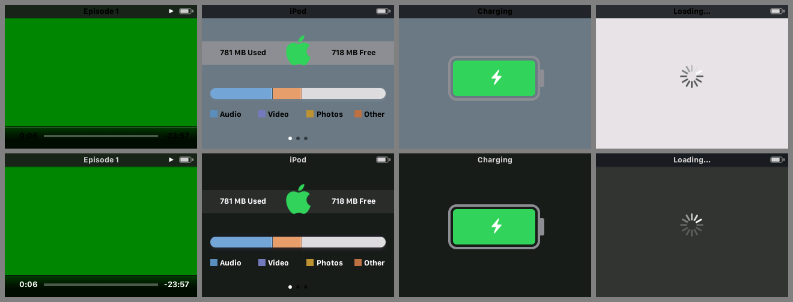

Video playback HUD, Settings > About, Charging, Games "Loading…"; also the Screen Lock, Alarms and Date &
Time pickers (#11) and the Stopwatch. The full-width title bar is near-black in both themes, but its
title, and the video HUD's elapsed and remaining times, follow `theme_text`. In Light they are black
on #1C1C1E and can't be read. Dark is fine.

- **Resources:** `NowPlaying_StatusBar_Image` 0x0dad082e (`modern_bars` fills it `near_black`
  in both modes, commented "its text stays white"). Probably the video HUD's bottom bar too.
- **Effort:** R. One change fixes every screen here: either give the bar the Light status-bar colour
  in Light, or draw these labels with `theme_white`. The Stopwatch fix in progress should use the
  same change rather than a Stopwatch-only one.

### 2. Split-view drop shadow and slate preview pane
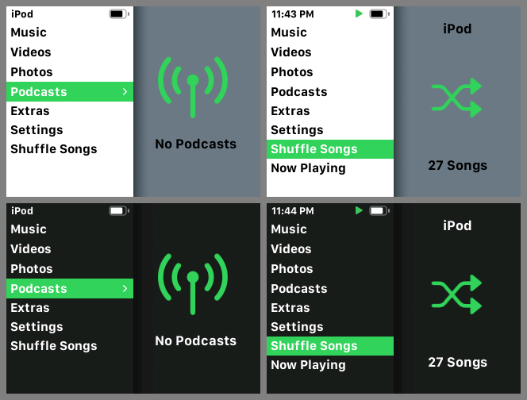

Every two-pane menu (main, Music, Videos, Extras, Settings…) has a soft dark gradient where the menu
meets the preview pane. That's Apple's 2007 drop shadow. In Light the empty pane is slate grey (known).

- **Resources:** `PreviewArea_Shadow_Image` 0x0dad00fa (26x240); `Background_LightBlue_Image`
  0x0dad00f9.
- **Effort:** R. Clear the shadow's alpha, or reduce it to a 1 px hairline in the separator colour.

### 3. Now Playing rating
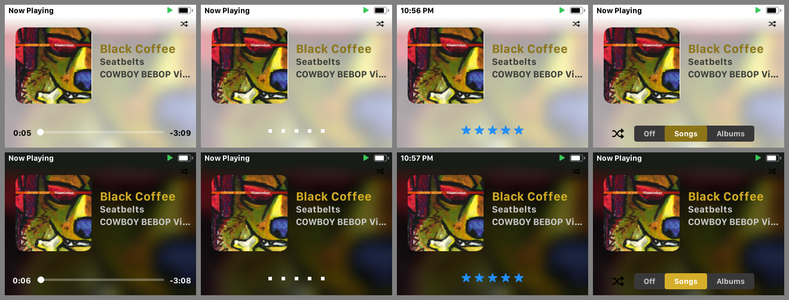

Pressing centre cycles scrubber → rating → shuffle bar. The empty rating is five white dots, which
vanish on a light cover blur in Light. The set stars are Apple's glossy blue in both themes, ignoring
both the accent and the cover accent.

- **Resources:** `NowPlaying_Blue_Star_Image` 0x0dad0848, `NowPlaying_Large_Blue_Star_Image`
  0x0dad0852, `NowPlaying_Blue_Dot_Image` 0x0dad0849, `NowPlaying_Dot_Image` 0x0dad0853,
  `NowPlaying_Star_Image` 0x0dad0847, `NowPlaying_Small_White/Grey_Star_Image` 0x0dad0850/0851.
- **Effort:** R. Fill the stars with the accent (add them to `np_acc_bm` so `--np-accent` covers
  them too). Draw the dots in the secondary label grey for each theme.

### 4. Now Playing shuffle bar and status glyphs
(Same montage, fourth column; plus `03-np-volume.png`.)

The option bar's track is #3A3A3C in both themes, so Light gets a dark iOS-6-style segmented control
on a pale background. In Dark the shuffle glyph left of the bar is black on black. The same goes for
the shuffle/repeat status glyph top right and the volume speakers, which are drawn black in both
themes (look at the speaker icons in the Dark volume shot).

- **Resources:** `np_opt_well` 0x0dad0159..015b; `NowPlaying_Large_Shuffle_Image` 0x0dad084a,
  `NowPlaying_Shuffle_Image` 0x0dad0830, `NowPlaying_Repeat(_Once)_Image` 0x0dad0831/0832,
  `NowPlaying_Black_Volume_Locked_Image` 0x0dad0856, `NowPlaying_White_Volume_*` 0x0dad0854..0857.
- **Effort:** R. Make the well colour depend on the theme (#E5E5EA in Light). Give the glyphs the
  theme's label colour, and set label ink for Light in `e_opbar_ink`.

### 5. Now Playing contrast in Light
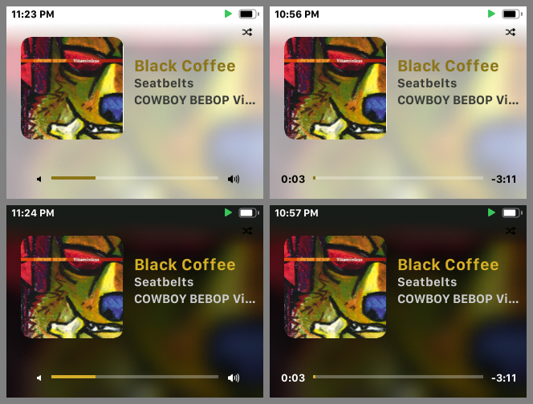

The accent title (cover-picked mustard here) sits at luma 110–170, which reads fine on the dark blur
but washes out on the light one. The progress and scrubber track is white on a near-white blur.

- **Resources:** `theme_cover`/`cover_pick` clamp (`theme.c`, `theme_rules.c`);
  `NowPlaying_ProgressBar_Active/Inactive_Background_Image` 0x0dad084d/084b,
  `NowPlaying_ProgressBar_Scrub_Image` 0x0dad084f.
- **Effort:** R. Use a darker luma clamp in Light (keep `rules_parity.py` in step), and draw the
  track in the theme's grey.

### 6. Placeholder tiles
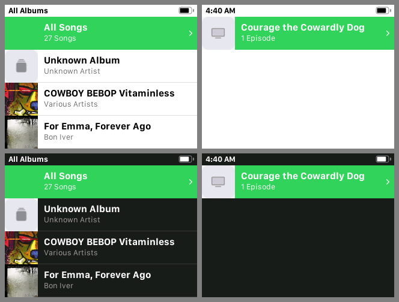

"Unknown Album" in Albums, and the TV show tile in Videos > TV Shows: a light-grey square in both
themes, which glares in Dark.

- **Resources:** `No_Content_Albums_Small_Image` 0x0dad00fb, `No_Content_TVShows_Small_Image`
  0x0dad0100, the rest of `No_Content_*_Small_Image` (0x0dad00fc..00ff, 0x0dad0101, all RGB565), and
  `CoverFlow_Proxy_Image` 0x0dad00f4.
- **Effort:** R. Remap their luminance into the dark range in Dark, the way the background class
  already does. An SF tile (a note or TV on a tinted square, like iOS) would be an I option.

### 7. Cover Flow
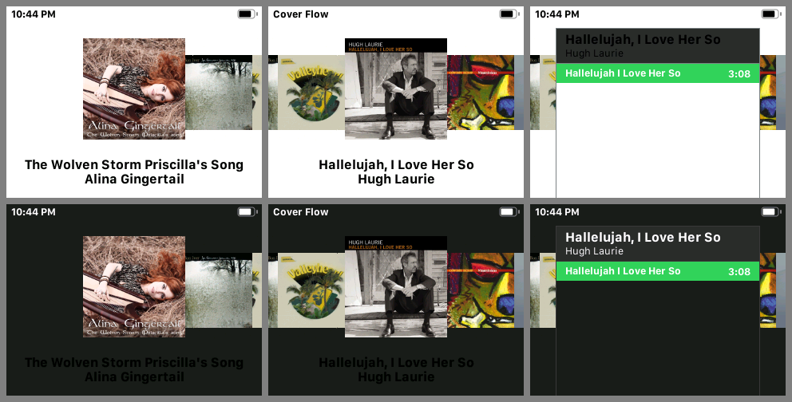

- **(a) Dark captions.** The first frame after entering draws the title and artist in black on the
  dark background. They turn white after the first wheel turn. **Effort:** C. The caption text views
  are probably built with a stored colour before the theme's stored-colour walk reaches them.
- **(b) Back-side header.** The header is charcoal in Light as well (`CoverFlow_Backside_Top_Image`
  0x0dad05a6, filled `band_dark` in both modes). **Effort:** R.
- **(c) Back-side frame.** The panel's side rules (`CoverFlow_Backside_Border_Color` 0x0dad05a4) run
  to the bottom of the screen, below a one-track list, so the panel looks unfinished. **Effort:** L.

### 8. Search keyboard
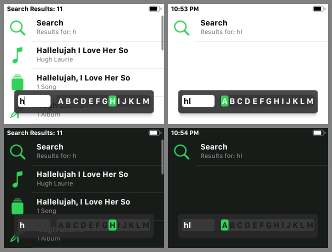

The letter strip HUD is the same dark slab in both themes. In Light it looks like a 2009 HUD over a
white list. In Dark the unselected letters are mid-grey on #3A3A3C, hard to read. The panel is also
translucent, so results show through behind the strip.

- **Resources:** `modern_panel` (`System_Overlay_Left/Middle/Right_Image` 0x0dad0141..0143,
  `TVOut_Background_*` 0x0dad087b..087d), `modern_well` (`OptionBar_Black_Well_*` 0x0dad0153..0155),
  `System_Input_Field_*` 0x0dad0163..0165.
- **Effort:** R. Use theme-dependent panel and well colours, light ink for the letters in Dark, and
  an opaque panel.

### 9. Playlist and Genius icons
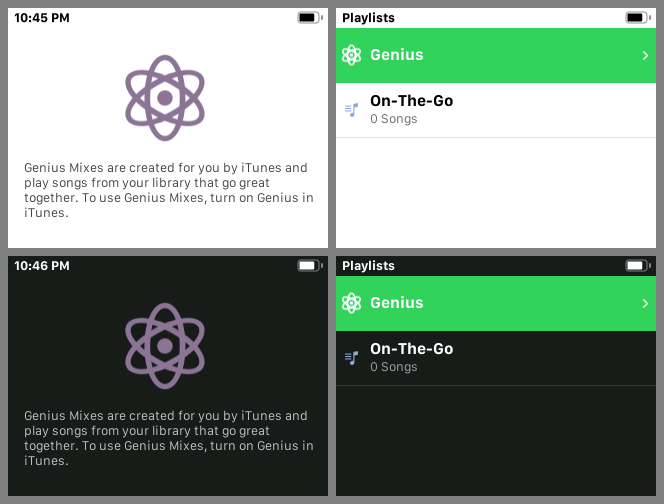

The On-The-Go row uses Apple's pale-blue list glyph, and Genius Mixes and Genius use the glossy purple
atom. Neither follows the accent or the SF set.

- **Resources:** `Playlist_Regular_Icon` 0x0dad0707, `Playlist_Smart_Icon` 0x0dad0706,
  `Playlist_Folder_Icon` 0x0dad0708, `Playlist_Genius_Icon(_Hi)` 0x0dad0703/0704,
  `Playlist_Saved_Genius_Icon` 0x0dad0705 (all ARGB); `Media_Genius_Large_Image` 0x0dad0700,
  `Media_Genius_Normal/Selected_Image` 0x0dad06fe/06ff, `NowPlaying_Genius_Icon` 0x0dad0889.
- **Effort:** I (e.g. `music.note.list` for playlists, `atom` or `sparkles` for Genius). Partition
  update.

### 10. Alerts and action sheets
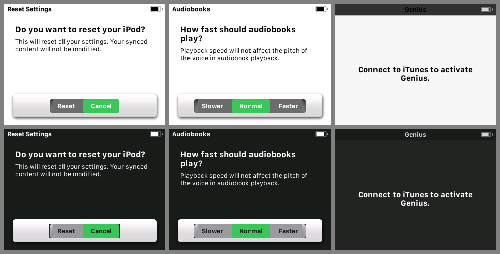

Reset Settings and Audiobooks speed (and, presumably, every two-choice confirmation) put a glossy
white tray with a bevelled grey segmented control at the bottom. In Dark it's a bright white slab.
The full-screen alert (Genius) is acceptable.

- **Resources:** `Lozenge_Left/Middle/Right_White_Image` 0x0dad0144..0146 (tray),
  `OptionBar_White_Well_*` 0x0dad014d..014f, `OptionBar_White_Thumb_*` 0x0dad0150..0152.
- **Effort:** R. Flatten them in `modern_bars` with theme colours (#F2F2F7 / #2C2C2E tray, grey well,
  accent thumb).

### 11. Tumbler pickers
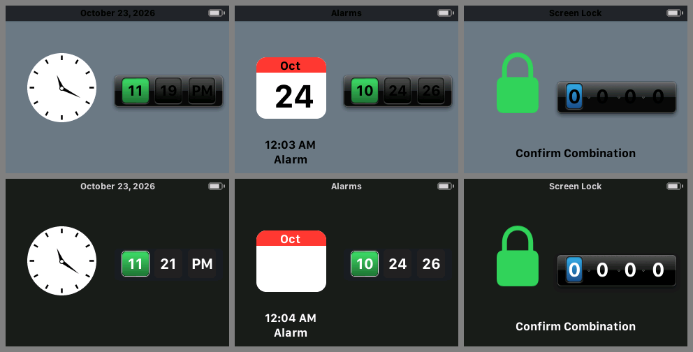

Settings > Date & Time, Alarms date and time, Screen Lock combination. In Light, Apple's glossy black
drum stays, and the unselected digits are black on it: unreadable. In Dark the date/time drum is
already flat, but its selection is still a glossy green lozenge. The combination drum is glossy in
both themes with an Apple-blue focus.

- **Resources:** `DateTimePicker_Bar/Selection/Well` 0x0dad0220..0222,
  `Settings_DateTime_Capsule_Image/_Hilite` 0x0dad05c1/05c2, `Alarms_Timer_Time_Panel(_Focus)`
  0x0dad02c5/02c6, `LockScreen_TumblerBgnd_Image` 0x0dad063e, `LockScreen_TumblerFocus_Image`
  0x0dad063f.
- **Effort:** R. Flat cells in both themes (light grey in Light) and an accent selection.

### 12. Calendar month grid
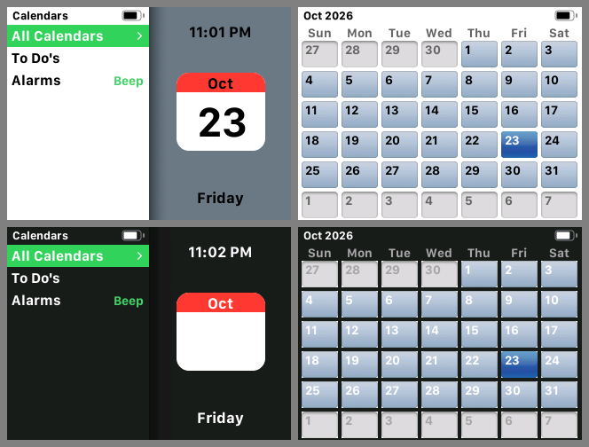

Glossy, bevelled, sky-blue day cells; today is a darker glossy blue. Unthemed in both themes, and in
Dark the white day numbers sit on pale blue.

- **Resources:** `Calendar_Active_Cell` 0x0dad0335, `Calendar_Inactive_Cell` 0x0dad0336,
  `Calendar_Hilite_Cell` 0x0dad0337; colours `Calendar_Weekday/Active/InActive/Hilite_Text_Color`
  0x0dad0312/0313/0314/0317.
- **Effort:** R. Flat cells (#F2F2F7 / #2C2C2E), today and selection in the accent.

### 13. Calendar icon without its day number (Dark)
Same montage, left column. The calendar page is white in both themes, but the day number is drawn
through a retargeted grey, so in Dark it's white on white. Affects the Calendars preview, the Date &
Time preview and the Alarms date picker (`09-pickers.png`).

- **Resources:** `Settings_DateTime_Calendar_Image` 0x0dad02d7, `Calendar_Preview_Day_Font`
  0x0dad000b.
- **Effort:** R/C. Find the colour literal the number uses and put it on the `KEEP` list (or point it
  at a fixed black) in `mkpatch18.py`.

### 14. World Clock
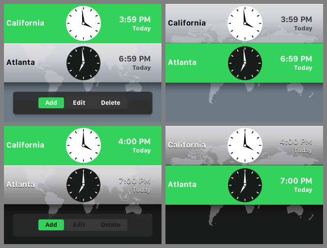

The unselected city rows are a glossy silver gradient. In Dark the city name and time stay white on
that silver and disappear. The Add/Edit/Delete HUD is a dark slab in Light (#15).

- **Resources:** `WorldClock_Graybar_Image` 0x0dad0455, `WorldClock_Map_Image` 0x0dad0456,
  `Clock_Small_Image`/`Clock_Small_Night_Image` 0x0dad0457/0458, `Clock_Shadow_Image` 0x0dad045b.
- **Effort:** R. Flat theme-coloured rows; maybe dim the map in Light.

### 15. Slider and option HUDs
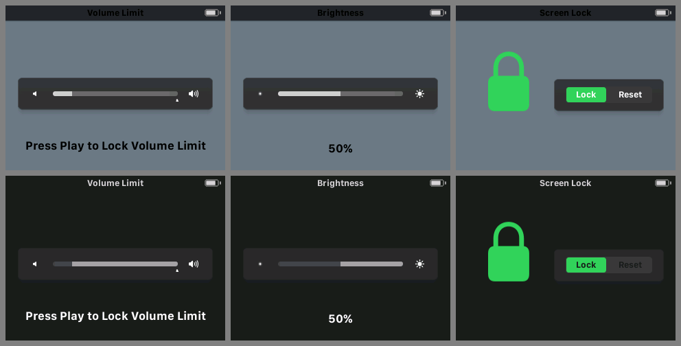

Volume Limit, Brightness, Clocks' Add/Edit/Delete and Screen Lock's Lock/Reset. Already flattened,
but `band_dark` in both themes, so Light shows a charcoal slab on a slate screen.

- **Resources:** `modern_panel`, `modern_well`, `modern_thumb` (see #8),
  `System_Overlay_Volume*/Brightness*` 0x0dad015f..0162.
- **Effort:** R. Theme-dependent fills; the same change as #8.

### 16. EQ preview
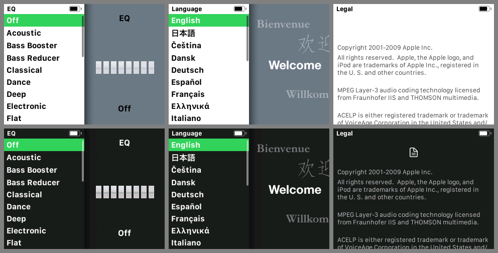

Twenty-two alpha masks with a glossy highlight band baked into each bar.

- **Resources:** `Settings_EQ_*_Image` 0x0dad0bd9..0bee (4-bit alpha, 130x79).
- **Effort:** I. Redraw them as flat rounded bars from the presets' gains in `gen_sficons.py`.

### 17. About
`08-dark-bars.png`, second column. The dark header comes from #1. The capacity bar is flat but uses
Apple's 2009 legend colours, and the band is a mid-grey strip (`Settings_About_Band_Image` 0x0dad0aa9,
`band_light` in Light).

- **Resources:** `Settings_About_Capacity_*` 0x0dad0aaa..0ab0, `CapacityView_*` 0x0dad0ab1..0ac6.
- **Effort:** R. iOS storage colours, and a band that matches the list background.

### 18. Language preview
`14-settings-previews.png`, middle column. "Bienvenue / 欢迎 / Willkommen" is one baked bitmap in a
Times-like serif with a soft grey wash, unlike any other preview.

- **Resources:** `Settings_Language_Image` 0x0dad0bcc (159x240).
- **Effort:** I. Re-render it in SF in `gen_sficons.py`.

### 19. Legal icon (Light)
`14-settings-previews.png`, right column. The document glyph above the text is drawn white, so it
only shows in Dark.

- **Resources:** `Settings_Legal_Image` 0x0dad0bca.
- **Effort:** R. Give it the label colour.

### 20. Games
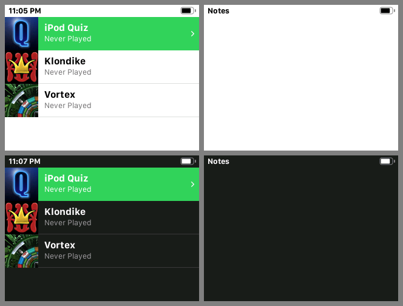

The game list art is each game's own (left alone). The "Loading…" screen is #E8E3E7 lavender-grey in
Light with the dark bar from #1. In the emulator every game stays on "Loading…", so the in-game screens
were not reached.

- **Effort:** R (background).

### 21. Notes, empty
Same montage, right column. With no notes, Notes is a blank screen with no empty-state message. The
preview pane has `No_Content_Notes_Preview_Image` 0x0dad0107, but the screen itself shows nothing.

- **Effort:** L/C. Low priority.

### 22. Battery icon
Flat and monochrome, which is fine. But it has no red state when low (the drain run went down to a
sliver of black), and with `PMUCHARGER=adapter` the status bar showed no bolt.

- **Resources:** `StatusBarWhite/Black_Battery_Image_0..22`, `_Charge`, `_Plug`
  (0x0dad010f..0140).
- **Effort:** R. Tint the low indices red and the charging index green. Check the charging state on
  the device: the emulator may not report it to the status bar.

### 23. Boot console
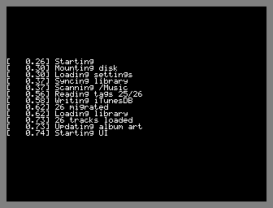

Our own `updscreen.c` log in a 5x7 font, seen on every cold boot and also used for the update
progress.

- **Effort:** C (our code). An Apple logo with a thin progress bar and one status line would match.

### 24. Hearing preview
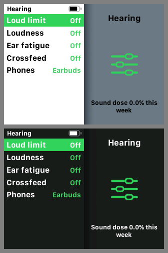

"Sound dose 0.0% this week" wraps onto a second line in the small preview font.

- **Effort:** L. Shorten the text ("0.0% this week") or let it fit.

## What already reads as modern
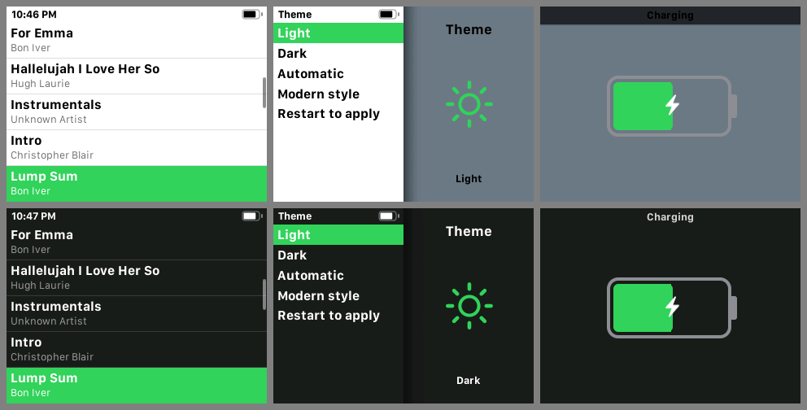

Lists and menus (SF Compact, kerned, accent highlight), the Settings rows we added, Now Playing's
steady layout (flat cover, blurred backdrop, accent progress), the charging battery, empty-state
previews (SF icons), and Search's result rows.

## Not reached in the emulator
- **Hold screen and hold icon:** the model has no hold switch (`StatusBar*_Lock_Image` 0x0dad010d/010e;
  the `NowPlaying_Idle_*` digits, battery and lock images 0x0dad0858..086d look like the idle clock).
- **USB / disk mode:** not modelled (`DiskModeImage_*`; theme.c already recolours the progress bar).
- **Low Battery screen:** PMUBATT 600 boots normally and 560/580 never reach the first frame;
  `PMUDRAIN` drains too slowly for a tour. Its art (`ChargingMode_Image_Critical`) is already redrawn.
- **Wheel letter overlay:** the 27-song library is too short. `System_QuickScroll_Image` 0x0dad00f2 is
  Apple's glossy black rounded square (see the stock sheet below); it is probably unthemed.
- **Others:** Genius slider (`Genius_Slider_*`), Cover Flow striping (one-track albums), alarm-fired
  alert (`Alarms_Alert_*`), photo viewer, podcast lists, lyrics, in-game screens.

Stock Apple pixels for some of the resources above (QuickScroll, preview shadow, world clock bar and
faces, calendar cells, pickers, white tray and option bar, blue stars and dots, playlist and Genius
icons, placeholder tiles, EQ bars, the black base panel, the Language bitmap):
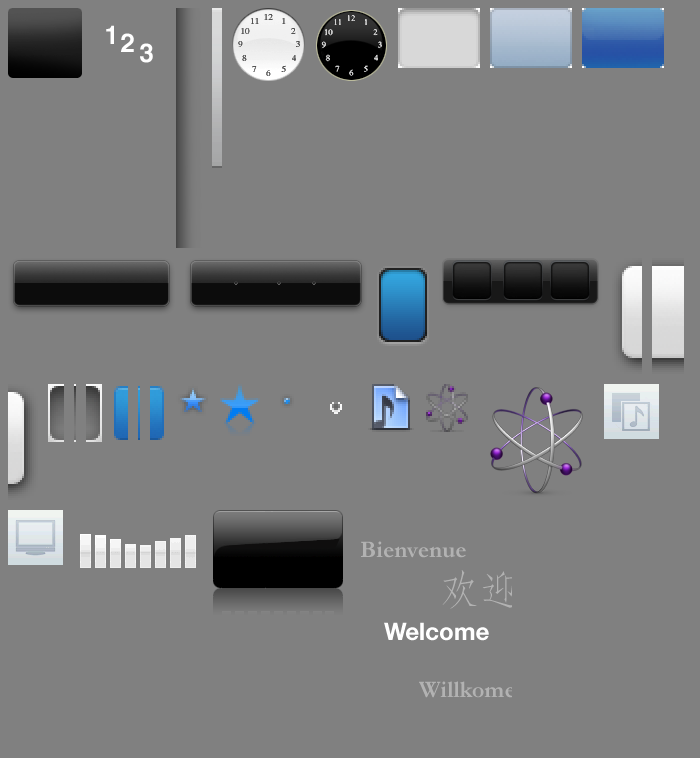

## Suggested order of work
1. **One theme.c pass for the screens seen most:**
   - #1, the title bar fix (also the Stopwatch title)
   - #2, the split shadow, with the known slate
   - #3 and #4, Now Playing rating and shuffle colours
   - #5, the Light contrast

   All R, no partition update. Now Playing alone is most of the time the screen is on.
2. **Flatten the rest of Apple's chrome in `modern_bars` with theme colours:**
   - #10 dialogs, #11 pickers, #15 HUDs and #8 Search (one family of panel, well and thumb fills)
   - #12 calendar, #14 world clock, #6 placeholders, #7b Cover Flow header
   - #13 calendar number, #19 Legal, #20 Loading, #22 battery

   Still R only.
3. **One partition update for new art:** #9 playlist and Genius icons, #16 EQ bars, #18 Language,
   plus SF placeholder tiles if #6 wants more than a recolour.
4. **Code and layout:** #7a Cover Flow captions, #7c back-side frame, #23 boot screen, #21 Notes, #24
   Hearing text.
